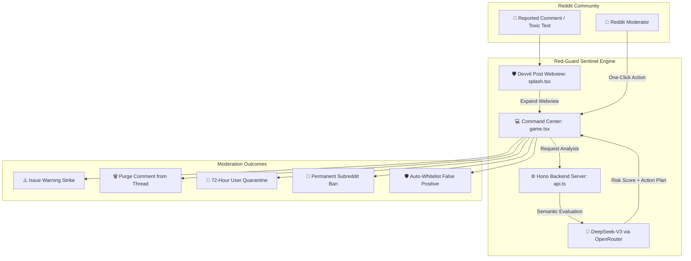

# 🛡️ Red-Guard
### Autonomous Subreddit Moderation Copilot & Real-Time Threat Intelligence Radar

<div align="center">

[](https://developers.reddit.com/)
[](https://developers.reddit.com/)
[](https://react.dev/)
[](https://openrouter.ai/)
[](https://hono.dev/)
[](./LICENSE)

---

### 🎯 Reddit Mod Tools Hackathon Project
**Red-Guard** was built as a project submission for the **Reddit Mod Tools & Community Apps Hackathon**. It was created to tackle one of the hardest challenges on the platform: **helping volunteer moderators deal with toxic discussions, harassment, spam waves, and risky user behavior without getting overwhelmed.**

[Hackathon Story](#-hackathon-origin--vision) • [The Problem](#-the-problem) • [How It Works](#-how-it-works) • [Key Features](#-key-features) • [Architecture](#-architecture) • [Getting Started](#-getting-started)

---

</div>

## 💡 Hackathon Origin & Vision

Reddit thrives because of passionate volunteer moderators who dedicate countless hours to keeping subreddits safe, civil, and welcoming. However:
- Viral threads often receive **thousands of comments per minute**.
- Coordinated bad actors and spam bot farms exploit off-peak hours when human moderators sleep.
- Reading through streams of abusive, threatening, or vulgar content leads to severe **moderator burnout**.

**Red-Guard** was built during the **Reddit Hackathon** to answer a key question:
> *"Can we give subreddit moderators an AI-powered co-pilot that lives directly inside Reddit, triages reports in milliseconds, explains why content violates policy, and enables decisive action with a single click?"*

Red-Guard acts as an **autonomous community sentinel** — combining **Reddit's Devvit 2.0 Webview runtime** with **DeepSeek-V3 LLM semantic analysis** to give moderators supercharged tooling right inside their subreddits.

---

## ⚡ The Problem vs The Red-Guard Solution

| Traditional Subreddit Moderation | With Red-Guard Copilot |
| :--- | :--- |
| **Manual ModQueue Sifting**: Mods must read hundreds of long, toxic threads manually. | **Instant Semantic Triage**: DeepSeek AI analyzes reported comments in < 1.5s. |
| **Slow Crisis Response**: Brigades and crypto scam bots stay up for hours before notice. | **Real-Time Radar**: Live incoming threat stream isolates attacks immediately. |
| **Subjective Decision Fatigue**: Hard to remember multi-rule nuances under pressure. | **Structured Insights**: Pinpoints exact rule violations (Rule 1, Doxxing, Phishing). |
| **Scattered Moderator Actions**: Multiple sub-menus needed to warn, mute, or remove. | **1-Click Enforcement Terminal**: Warn, Purge, Mute 72h, Ban, or Whitelist instantly. |

---

## 🔄 System Architecture & Data Flow



---

## ✨ Core Features & Highlights

### 1. 🛡️ Native Inline Reddit Post View (`splash.tsx`)
- Embeds directly into any subreddit feed as an interactive Reddit post.
- **Live Community Sentinel Pulse**: Real-time status badge showing active subreddit protection.
- **Real-Time Threat Ticker**: Cycles through recently intercepted incidents directly in the feed.
- **Community Telemetry Strip**: Displays live queue size, 98.4% AI precision score, and triage latency.
- **One-Click Launcher**: Expands instantly into the full-screen command center.

### 2. 💻 Full-Screen Moderator Command Center (`game.tsx`)
- **Multi-Level Filters & Search**: Filter queue by severity (`HIGH`, `MEDIUM`, `LOW`), review status, or username.
- **🧠 DeepSeek AI Deep Scan**: Evaluates intent vectors, violation patterns, and community harm.
- **🧪 "+ Test Incident" Testing Suite (Hackathon Showcase)**:
  - An interactive modal allowing judges, developers, and testers to input any custom toxic text or phishing link.
  - Generates live risk scores, updates community radar, and simulates instant AI triage.
- **⚡ 5-Action Enforcement Terminal**:
  - ⚠️ **Warn User**: Official strike notification.
  - 🗑️ **Remove Comment**: Instant thread cleanup.
  - 🔕 **Temporary Mute**: 72-hour quarantine from commenting and modmail.
  - 🔨 **Permanent Ban**: Permanently restricts malicious offenders.
  - 🛡️ **Approve & Clear**: Restores false-positive reports.
  - ⚡ **Auto-Clear Low Risk**: One-click batch cleanup for low-confidence flags.
- **🔊 Sci-Fi Web Audio Synthesizer**:
  - Built-in, zero-dependency browser Web Audio synth providing auditory feedback on selections and actions.
  - Includes a quick **Sound ON/OFF toggle** in the top bar.
- **🟢 Live Threat Stream Controls**:
  - Pause or resume the simulated threat influx stream.
  - **📥 Export Mod Audit Log**: Download complete timestamped moderation records as a JSON file.

---

## 🛠️ Built With

- **Platform**: [Reddit Developer Platform (Devvit 2.0)](https://developers.reddit.com/)
- **Frontend**: React 19, TypeScript, Tailwind CSS 4
- **Backend API**: Hono, Node.js (`@hono/node-server`)
- **AI & NLP Engine**: OpenRouter API (`deepseek/deepseek-chat`)
- **Build Tooling**: Vite 8, Rollup, ESLint 10

---

## 🏁 Quickstart & Local Setup

### Prerequisites
- Node.js `>= 22.2.0`
- Reddit Developer account & Devvit CLI installed:
  ```bash
  npm install -g devvit
  ```

### 1. Installation
```bash
git clone https://github.com/dhruv-lx/red-guardian-ai.git
cd red-guardian-ai
npm install
```

### 2. Configure Environment (Optional)
Copy `.env.example` to `.env`:
```env
OPENROUTER_API_KEY="your-openrouter-deepseek-key-here"
```
*(Note: Red-Guard includes an intelligent local semantic heuristic engine, so the entire dashboard and triage simulator run 100% offline without requiring an API key for evaluation).*

### 3. Run Locally in Devvit Playtest
```bash
npm run dev
```
Open your local test subreddit (default: `r/red_guardian_ai_dev`) to see the interactive Red-Guard post live on Reddit!

### 4. Code Quality & Build Verification
```bash
# Type check all TypeScript workspaces
npm run type-check

# Verify ESLint rules
npm run lint

# Build production bundle
npm run build
```

---

## 📌 Reddit Hackathon Submission Notes

- **Submission Name**: Red-Guard
- **Target Category**: Mod Tools & Automated Community Infrastructure
- **Core Goal**: Mitigating volunteer moderator burnout and securing subreddits against coordinated toxicity through accessible, human-in-the-loop AI tooling.

---

<div align="center">
  <b>Red-Guard — Built with ❤️ for Reddit moderators and communities worldwide.</b>
</div>
